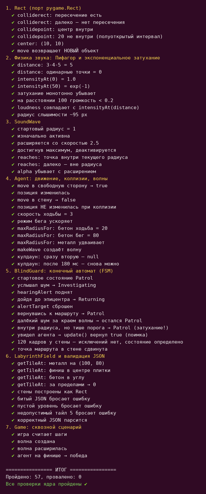

# js_sound_spy — ядро Sound Spy на JavaScript

Порт игрового ядра «Звукового шпиона» с Python/Pygame на **JavaScript (ES6+)**:
те же сущности, та же физика, тот же конечный автомат — но без отрисовки,
поэтому ядро работает в Node.js и проверяется автотестами.

**Что внутри:**

1. **Объектно-ориентированная структура** — классы `Agent`, `BlindGuard`, `SoundWave`, `LabyrinthField`
2. **Физика звука** — интенсивность по формуле `I(d) = I₀ · exp(−k·d)`,
   расстояние между точкой шага и охранником — по теореме Пифагора;
   реакция срабатывает только при `I(d) ≥ порога`, а не по голому радиусу
3. **Конечный автомат (FSM) охранника** — состояния `Patrol`, `Investigating`, `Returning`
   с возвратом к прерванной точке маршрута

## Структура

```
js_sound_spy/                # ядро — только логика, без интерфейса
├── package.json            # type: module — запуск ES-модулей в Node
├── README.md
├── selftest.js             # самопроверка: 57 проверок (node selftest.js)
└── js/
    ├── constants.js        # все параметры игры (аналог constants.py)
    ├── rect.js             # Rect — порт возможностей pygame.Rect
    ├── sound_physics.js    # Пифагор, экспоненциальное затухание, порог слышимости
    ├── sound_wave.js       # SoundWave — расширяющаяся волна
    ├── agent.js            # Agent — движение, коллизии, генерация волн
    ├── blind_guard.js      # BlindGuard — FSM, слух по затуханию, зрение
    ├── labyrinth_field.js  # LabyrinthField — тайлы, стены, валидация JSON
    └── game.js             # Game — игровой цикл без отрисовки
```

## Запуск

Нужен только Node.js 18+ (без установки зависимостей).

```bash
cd js_sound_spy

# самопроверка (57 проверок: геометрия, физика, FSM, коллизии, JSON, цикл)
node selftest.js
```



> **Про интерфейс.** В этой версии только ядро — без отрисовки и ввода:
> его можно проверить целиком в консоли, без браузера.

## Ключевые отличия от Python-версии py_sound_spy

| Аспект | py_sound_spy (Python) | js_sound_spy (JavaScript) |
|---|---|---|
| Модули | `import from py_sound_spy.x` | ES-модули `import … from './js/x.js'` |
| Прямоугольники | `pygame.Rect` | собственный класс `Rect` (move/colliderect/collidepoint) |
| FSM охранника | `match/case` | `switch` |
| Слух | проверка радиуса волны (`dist <= wave.radius`) | **радиус + порог громкости** `I(d) ≥ 0.15` |
| Затухание | визуальная alpha при отрисовке | физическая функция в `sound_physics.js` + визуальная alpha |
| Данные уровня | `spy_level.json` + `data_io.load_level_config` | `LabyrinthField.fromJSON()` с той же валидацией |
| Отрисовка | цикл в `game.py` | не реализована — ядро от неё не зависит |

## Возможности ядра

- [x] Классы `Agent`, `BlindGuard`, `SoundWave`, `LabyrinthField` — независимые, каждый в своём модуле
- [x] `sound_physics.intensityAt(d)` — экспоненциальная формула затухания
- [x] `distance(x1, y1, x2, y2)` — расстояние по теореме Пифагора (`Math.hypot`)
- [x] FSM: `Patrol → Investigating → Returning` + возврат к прерванной точке маршрута
- [x] Защита от застревания, скольжение вдоль стен, «прямая видимость» — как в Python-версии
- [x] Загрузка уровня из JSON с валидацией (`try/catch` + проверка полей)
