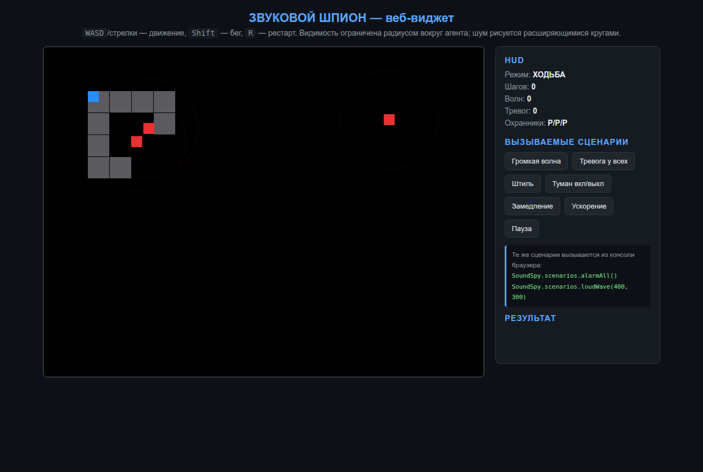

# js_widget — веб-виджет «Звуковой шпион» на Canvas

Интерактивный веб-виджет: HTML5 Canvas, игровой цикл `requestAnimationFrame`,
ввод с клавиатуры через массив-флаги, анимация звуковых волн и вызываемые сценарии.
Игровая логика полностью переиспользуется из ядра [`../js_sound_spy`](../js_sound_spy) —
виджет занимает только отрисовкой, вводом и сценариями.

## Структура

```
js_widget/
├── index.html              # разметка страницы: canvas, HUD, кнопки сценариев
├── css/
│   └── style.css           # тёмная тема оформления
├── js/
│   ├── widget.js           # цикл, ввод, отрисовка, HUD
│   └── scenarios.js        # вызываемые сценарии (консоль + кнопки)
├── screenshots/
│   └── widget.png          # скриншот работающего виджета
└── README.md
```

## Запуск

Нужен статический сервер (ES-модули не работают через `file://`):

```bash
cd sound_spy/js_widget
python3 -m http.server 8000
# открыть http://localhost:8000/js_widget/index.html
```

Зависимостей нет: только браузер и Node.js 18+ (для ядра).

## Управление

| Клавиша | Действие |
|---|---|
| `WASD` / стрелки | движение агента |
| `Shift` | бег (громче, волна шире) |
| `R` | рестарт после финала |

## Вызываемые сценарии

Сценарий — именованная функция, меняющая поведение виджета. Вызывается
кнопками на панели или из консоли браузера:

```javascript
SoundSpy.scenarios.loudWave(400, 300);   // громкая волна в точке
SoundSpy.scenarios.alarmAll();           // все охранники в тревогу
SoundSpy.scenarios.calm();               // вернуть к патрулированию
SoundSpy.scenarios.toggleFog();          // туман видимости вкл/выкл
SoundSpy.scenarios.slowMotion(0.35);     // замедление симуляции
SoundSpy.scenarios.speedUp(2.5);         // ускорение
SoundSpy.scenarios.pause();              // пауза / продолжение
SoundSpy.scenarios.restart();            // новая партия
```

## Что реализовано

- [x] Игровой цикл `requestAnimationFrame` с фиксированным шагом симуляции (60 Гц)
- [x] Экран залит чёрным; уровень и стены видны только в радиусе `VISIBLE_RADIUS` вокруг агента
- [x] Анимация акустики: расширяющиеся круги `rgba(255, 0, 0, alpha)`, `alpha` убывает с радиусом
- [x] Ввод через массив-флаги `keys{}` — опрос состояния, без задержек ОС
- [x] Анимированный индикатор тревоги над охранником в состоянии `Investigating`
- [x] HUD: режим, шаги, волны, тревоги, состояния охранников
- [x] Сценарии как модуль с реестром функций + `window.SoundSpy` API
- [x] Логика — из ядра (`Game`, `Agent`, `BlindGuard`, `SoundWave`, `LabyrinthField`)


