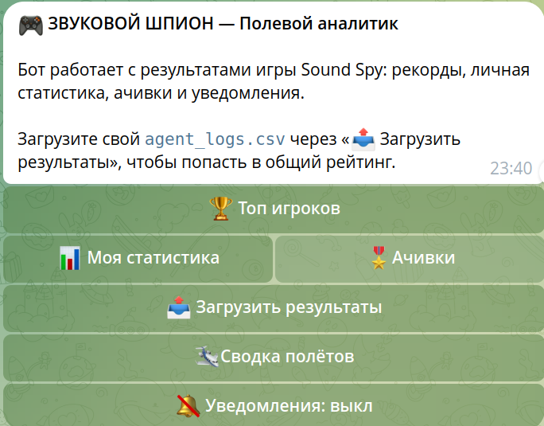
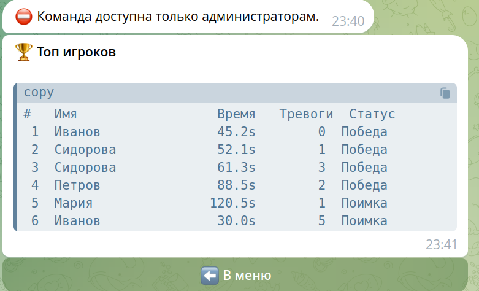
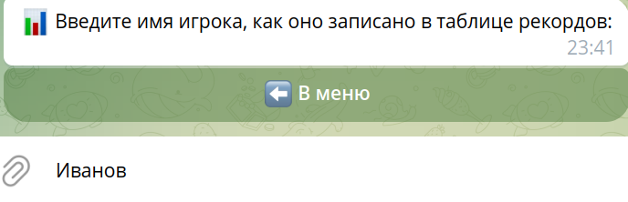
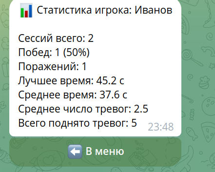
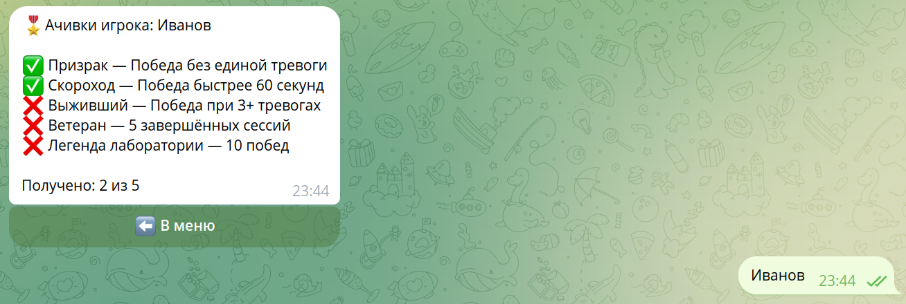
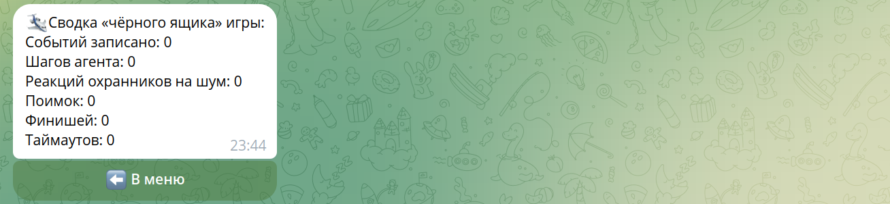
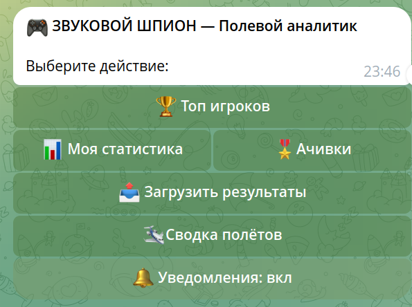

# Sound Spy — Полевой аналитик (ЛР 3)

Telegram-бот для игры Sound Spy. Бот является **сервисом-помощником** игры, а не её копией в чате: игровая логика остаётся в Pygame-приложении `py_sound_spy`, а бот работает с данными, которые игра выгружает.

## Что умеет бот

| Функция | Описание |
|---------|----------|
| `/top` | Таблица лидеров по базе результатов: победы — по времени, поражения — по времени выживания |
| `/stats [имя]` | Личная статистика: игр, побед, winrate, лучшее и среднее время, среднее число тревог |
| `/achievements [имя]` | Ачивки: «Призрак» (победа без тревог), «Скороход» (< 60 с), «Выживший» (победа при 3+ тревогах), «Ветеран» (5 сессий), «Легенда лаборатории» (10 побед) |
| `/upload` | Загрузка `agent_logs.csv` в общую базу с построчной верификацией |
| `/watch` | Подписка на уведомления о новых результатах в базе |
| `/restart` | Сброс сессии (имя, подписка, экран) и возврат в меню — как при первом запуске |
| `/flight` | Сводка «чёрного ящика»: шаги, тревоги, поимки, финиши, таймауты |
| `/log N` | Хвост `game_flight.log` (только админам) |
| `/broadcast` | Рассылка подписчикам (только админам) |

## Источники данных

Игра пишет файлы (см. `py_sound_spy/data_io.py`):

- `agent_logs.csv` — строка на сессию: `Имя, Время, Тревоги, Статус`
- `game_flight.log` — события игрового цикла с timestamp

Бот хранит их копии в `py_bot/data/`. Пользователи могут прислать свои CSV через `/upload` — бот проверяет каждую строку и дописывает корректные записи в общую базу.

## Архитектура

```
py_bot/
├── bot.py          # Точка входа, хендлеры, FSM
├── session.py      # Stateless JSON-сессии по user_id (sessions/<id>.json)
├── analytics.py    # Парсинг CSV/логов, рекорды, статистика, ачивки
├── keyboards.py    # Инлайн-клавиатуры
├── config.py       # Токен из .env, пути, параметры
├── requirements.txt
└── .env.example
```

- **Stateless**: состояние пользователя (имя, подписка, id экрана) хранится в `sessions/<user_id>.json` и переживает перезапуск бота.
- **FSM** (aiogram 3): `MENU`, `UPLOAD`, `BROADCAST`, `WAIT_NAME`.
- **Антифлуд**: любой экран обновляется через `edit_message_text` — id сообщения-экрана (и его чат) хранится в сессии; ошибки `message is not modified` и «сообщение удалено» обрабатываются корректно; новые сообщения — только уведомления подписчикам и рассылки.
- **Верификация**: загружаемые результаты проверяются (корректность чисел, допустимые статусы, лимит времени уровня 120 с).

## Запуск

```bash
cd sound_spy/py_bot
pip install -r requirements.txt
cp .env.example .env   # вставить токен от @BotFather
python3 bot.py
```

Опционально: скопировать `py_sound_spy/agent_logs.csv` и `py_sound_spy/game_flight.log` в `py_bot/data/`, чтобы бот видел уже накопленные результаты.

## Перезапуск

1. Остановить бота: `Ctrl+C` в терминале, где он запущен (в логе появится
   `Received SIGTERM signal` → `Polling stopped`).
2. Убедиться, что не осталось второго экземпляра (`ps aux | grep "[p]ython3 bot.py"`) —
   два процесса конкурируют за `getUpdates` и дают ошибку `409 Conflict`
   (обёртка `sh -c` рядом с процессом в выводе — это норма).
3. Запустить снова: `python3 bot.py`.
4. Убедиться по логу, что бот живой:
   `tail -3 logs/bot_flight.log` → `Bot started` / `Run polling for bot @<имя>`.

## Проверка функционала

### Шаг 1. Офлайн-тест (без Telegram, ~5 секунд)

```bash
python3 selftest.py
```

Ожидание: `PASSED=27  FAILED=0`. Тест прогоняет диалоги через `Dispatcher`
с моком Bot API: `/start`, антифлуд (экраны правятся через `edit_text`),
ввод имени, загрузка корректного и битого CSV, уведомления подписчикам,
права админа, изоляцию сессий, кнопку «В меню» из экрана ввода и
устойчивость к сетевому сбою (любое падение хендлера = провал теста).

### Шаг 2. Живая проверка в Telegram

Откройте чат со своим ботом и по порядку:

| Действие | Ожидаемый результат |
|---|---|
| `/start` | Меню с кнопками, `state=MENU` в `sessions/<user_id>.json` |
| «🏆 Топ игроков» | Таблица лидеров; **сообщение-меню редактируется, новых сообщений нет** |
| «📊 Моя статистика» | Просит ввести имя (экран «Введите имя игрока…») |
| отправить текст `Иванов` | Статистика: сессии, победы, winrate, лучшее/среднее время |
| «🎖 Ачивки» | Список из 5 наград с ✅/❌ и счётчик |
| «📤 Загрузить результаты» → прислать CSV | `Добавлено записей: N`; записи в конце `data/agent_logs.csv` |
| прислать битый CSV | `Отклонено строк: …` с причинами, бот не падает |
| «🛩 Сводка полётов» | Счётчики «чёрного ящика» (шаги, тревоги, поимки…) |
| «🔔 Уведомления: вкл» | В сессии `subscribed=true` |
| быстрые повторные нажатия кнопок | Сообщений в чате не прибавляется — это антифлуд |
| `/top`, `/stats Иванов`, `/achievements Сидорова`, `/help`, `/watch`, `/restart`, `/flight` | Ответ команды (тоже через редактирование экрана) |

Уведомления: с двух аккаунтов — один подписывается («Уведомления: вкл»),
второй загружает CSV с победой; подписчик получает `Новый результат в базе`.

Админ-команды: без `ADMIN_IDS` в `.env` бот отвечает `⛔ …только для
администраторам`; добавив свой id в `.env` и перезапустив бота, проверьте
`/log 10` (хвост `game_flight.log`) и `/broadcast` (рассылка подписчикам).

### Шаг 3. Контроль по логу

```bash
tail -f logs/bot_flight.log
```

Каждое действие логируется: `/start`, `кнопка «топ»`, `/stats Иванов`,
`загружено N записей, M отклонено`, `подписка -> True`. Если какая-то
кнопка «не работает» — в логе будет traceback (так нашёлся баг с `cb_menu`).

### Шаг 4. Контроль по файлам

- `sessions/<user_id>.json` — по файлу на пользователя: `state`, `name`,
  `subscribed`, `screen_message_id`/`screen_chat_id` (изоляция сессий).
- `data/agent_logs.csv` — растёт после каждой загрузки, заголовок один.
- `logs/bot_flight.log` — `Timestamp | LEVEL | сообщение`.

## Типичные проблемы

| Симптом | Причина и решение |
|---|---|
| В логе `409 Conflict` | Запущены две копии бота — оставить одну |
| `Unauthorized` при старте | Неверный/отозванный токен в `.env` |
| Кнопка не реагирует | Смотреть traceback в `logs/bot_flight.log` |
| Экран устарел (правка не идёт) | Бот отправляет новый экран — так и задумано (сообщение удалено/устарело) |
| В логе `TelegramNetworkError` | Временный сетевой таймаут; бот делает одну повторную попытку и уведомляет пользователя через `@dp.errors()` |
| Не приходит уведомление | Проверить `subscribed=true` в сессии подписчика |

- **Обработка ошибок**: при сетевом сбое (`TelegramNetworkError`) экран отправляется ещё раз (одна повторная попытка), а глобальный `@dp.errors()` логирует любое падение хендлера и уведомляет пользователя (`⚠️ Временный сбой`) — бот продолжает работать.

## Доступ администратора

id администраторов перечисляются в `.env` (`ADMIN_IDS=111,222`) — им доступны `/log N` и `/broadcast`.

## Скриншоты

### Главное меню (`/start`)



### Топ игроков



Победы сортируются по времени, поражения — по времени выживания.

### Запрос имени игрока



Имя запоминается в сессии и используется по умолчанию.

### Личная статистика



### Ачивки



### Приглашение загрузить результаты


### Отчёт о загрузке (верификация)


Корректные записи добавляются в общую базу, битые отклоняются с указанием строки и причины.

### Сводка «чёрного ящика» игры



### Подписка на уведомления



### Проверка прав (админские команды)


## Зависимости
