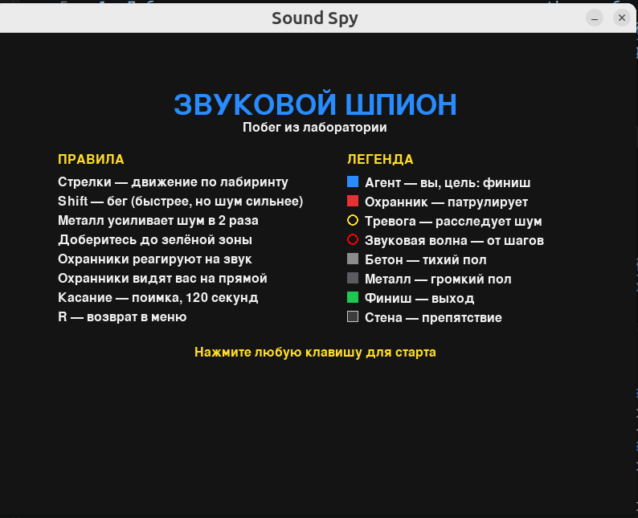
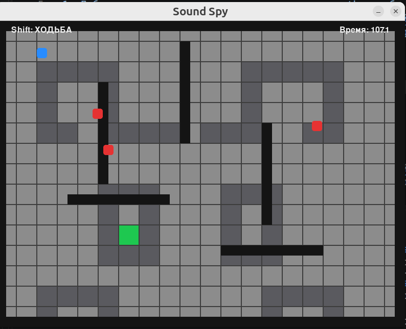
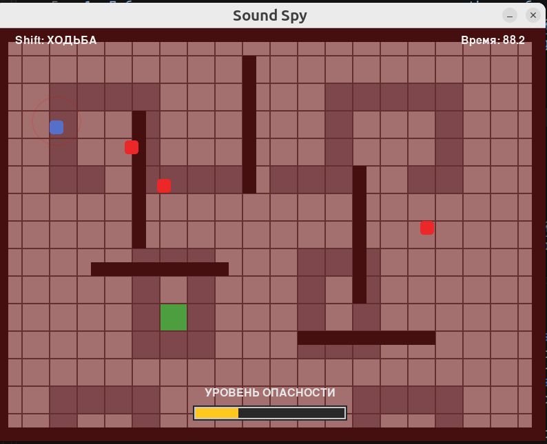
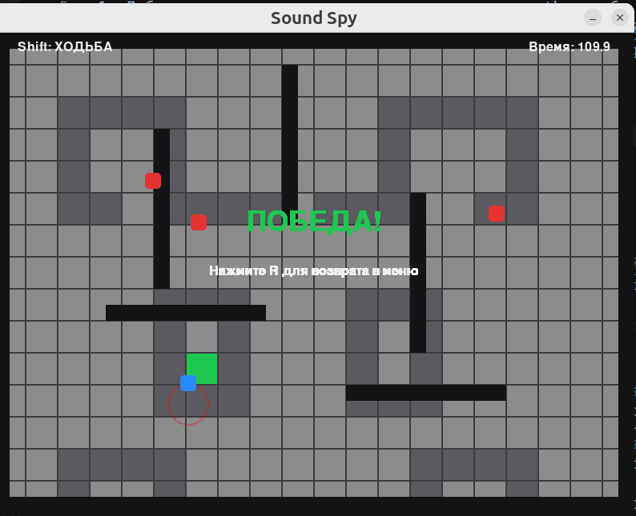
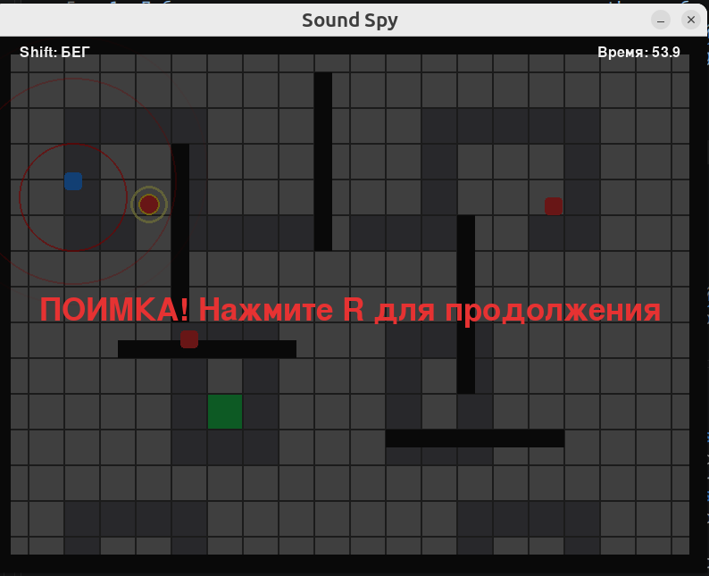

# Sound Spy
## «Звуковой шпион: Побег из лаборатории»

Sound Spy — это 2D стелс-симулятор с динамической акустикой.

Игрок управляет агентом, который должен незаметно добраться до выхода из лаборатории, избегая слепых, но чутких охранников. Любое перемещение generates звуковые волны: если охранник пересекает волну, он переключается в режим расследования и направляется к эпицентру шума.

---

## Стек технологий

- **Python 3.12**
- **Pygame 2.6.1** — графический движок, обработка ввода и отрисовка

---

## Структура проекта

```
sound_spy/py_sound_spy/
├── main.py           # Точка входа в приложение
├── __init__.py       # Документация пакета
├── constants.py      # Все общие константы: размеры, цвета, уровень, состояния
├── game.py           # Основной игровой цикл и логика игры
├── level.py          # Работа с тайлами лабиринта и отрисовка уровня
├── sound_wave.py     # Класс звуковой волны
├── agent.py          # Класс игрового агента
├── blind_guard.py    # Класс охранника с ИИ и конечным автоматом
└── ui.py             # Интерфейс: меню, HUD, overlay, экраны завершения
```

### Назначение модулей

| Модуль | Назначение |
|--------|-----------|
| `constants.py` | Все числовые параметры, цвета, матрица уровня, стены, тексты |
| `game.py` | Игровой цикл, обработка ввода, обновление объектов, отрисовка |
| `level.py` | Определение типа плитки по координатам, отрисовка лабиринта |
| `sound_wave.py` | Звуковая волна: расширение, затухание, отрисовка |
| `agent.py` | Агент: движение, коллизии, создание волн |
| `blind_guard.py` | Охранник: патрулирование, слух, зрение, конечный автомат |
| `ui.py` | Меню, легенда, индикатор опасности, экран поимки, финальный экран |

---

## Запуск игры

Запуск из папки `sound_spy/py_sound_spy/`:

```bash
cd sound_spy/py_sound_spy/
python3 main.py
```

---

## Управление

| Клавиша | Действие |
|---------|----------|
| `↑` `↓` `←` `→` или `W` `A` `S` `D` | Перемещение агента |
| `Shift` (зажатый) | Бег (быстрее, но шум сильнее) |
| `R` | Возврат в меню (после завершения игры) |
| `Закрыть окно` | Выход из игры |

---

## Механики игры

### 1. Движение и звук

- Агент перемещается по свободным ячейкам лабиринта.
- При каждом шаге создаётся круговая звуковая волна.
- Радиус волны:
  - **ходьба**: 20 пикселей
  - **бег**: 80 пикселей
  - **металлическая решётка**: радиус удваивается
- Между волнами есть небольшой кулдаун, чтобы избежать спама.

### 2. Охранники

Охранники имеют конечный автомат с тремя состояниями:

| Состояние | Описание |
|-----------|----------|
| `Patrol` | Патрулирование по фиксированному маршруту |
| `Investigating` | Расследование источника шума или преследование агента |
| `Returning` | Возврат к прерванному маршруту |

#### Реакция на звук
- Если звуковая волна достигает охранника — он переключается в `Investigating` и движется к эпицентру шума.
- Вокруг охранника появляется пульсирующее жёлтое кольцо (слуховой индикатор), которое плавно затухает.

#### Реакция на зрение
- Если агент попадает в радиус зрения (90px) и между ними нет стен — охранник сразу переключается в `Investigating`.

#### Движение
- Охранники двигаются со скольжением вдоль стен, чтобы не застревать.
- При отсутствии движения в течение 90 кадров — автоматический переход к следующей точке маршрута.

### 3. Типы плиток

| Символ | Тип | Описание |
|--------|-----|---------|
| `0` | Бетон | Тихий пол, радиус волны 20px (ходьба) или 80px (бег) |
| `1` | Металл | Громкий пол, радиус волны удваивается |
| `2` | Финиш | Цель игрока, выход из лаборатории |

### 4. Условия победы и поражения

| Исход | Условие |
|-------|---------|
| **Победа** | Агент достиг финиша (зелёная зона) |
| **Поражение** | Агент столкнулся с охранником |
| **Таймаут** | Истекло 120 секунд |

---

## Интерфейс

### Стартовый экран
- Заголовок «ЗВУКОВОЙ ШПИОН»
- Две колонки: **ПРАВИЛА** и **ЛЕГЕНДА**
- Подсказка «Нажмите любую клавишу для старта»

### Игровой экран
- Сетка лабиринта с агентом (синий квадрат), охранниками (красные квадраты), волнами (красные круги)
- Индикатор режима: `ХОДЬБА` / `БЕГ`
- Таймер: оставшееся время в секундах
- Шкала «УРОВЕНЬ ОПАСНОСТИ» при приближении к охранникам
- При поимке: затемнённый overlay с сообщением «ПОИМКА!»

### Финальный экран
- `ПОБЕДА!` (зелёный) — агент достиг финиша
- `Время вышло!` (жёлтый) — истек таймер
- `ПОИМКА!` (красный) — агент пойман
- Подсказка «Нажмите R для возврата в меню»

---

## Конфигурация

Все параметры игры хранятся в `constants.py`:

```python
TIME_LIMIT_SECONDS = 120    # лимит времени
DANGER_RADIUS = 160         # радиус детекта опасности
WALK_RADIUS = 20            # радиус волны при ходьбе
RUN_RADIUS = 80             # радиус волны при беге
GUARD_VIEW_RADIUS = 90      # радиус зрения охранника
GUARD_SPEED_PATROL = 1.6    # скорость патрулирования
GUARD_SPEED_INVESTIGATE = 3.2  # скорость расследования
```

Для изменения маршрута охранников отредактируйте списки точек в `game.py`:

```python
guards = [
    BlindGuard([(200, 160), (400, 160), (400, 360), (200, 360)], 0),
    BlindGuard([(620, 120), (620, 320)], 0),
    BlindGuard([(160, 160), (160, 480), (360, 480), (360, 240)], 0),
]
```

---

## Скриншоты

### Стартовый экран

Заголовок, правила управления и легенда элементов игры.

### Игровой процесс

Агент перемещается по лабиринту, создавая звуковые волны.

### Реакция охранника

Охранник переходит в состояние Investigating и движется к источнику шума.

### Экран победы

Агент достиг финиша — зелёная зона в центре лабиринта.

### Экран поимки

Агент пойман охранником — затемнённый overlay с сообщением.

---

## Зависимости

Убедитесь, что установлен Python 3.12+ и Pygame 2.6.1:

```bash
python3 -c "import pygame; print(pygame.__version__)"
```

Если Pygame не установлен:

```bash
pip install pygame
```

